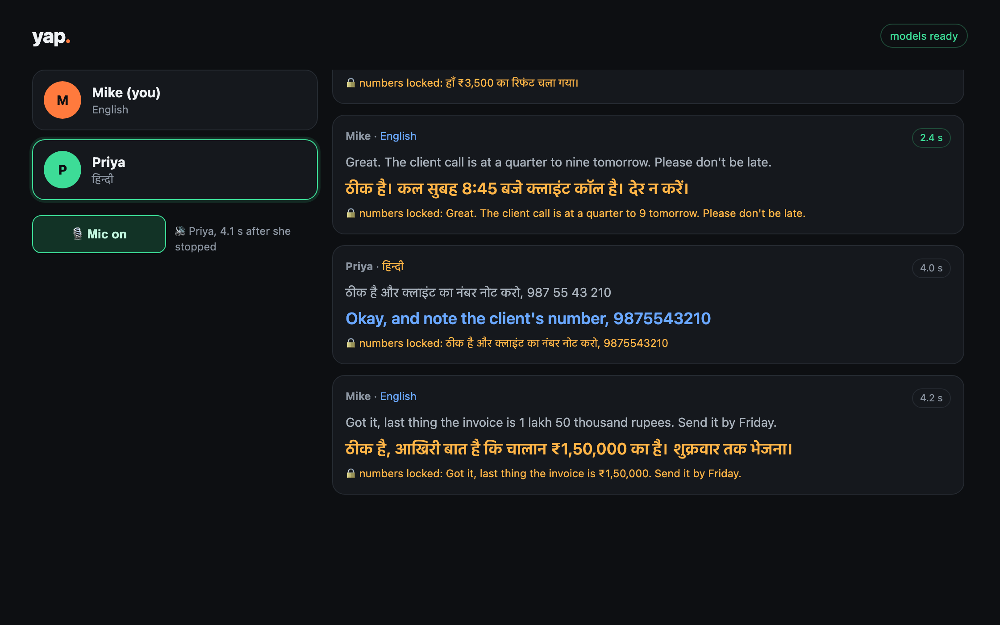

# yap.

**Yap in your language. They hear it in theirs, in your own voice.**

Yap is a live call translator that runs fully on a laptop. You speak Hindi (or Hinglish), the other person
hears English **in your voice**, about 4 seconds later. They reply in English, and you hear Hindi in **their** voice.
No cloud, no API keys, no account. Your voice never leaves the machine.



## Why

Voice translation already exists in big meeting apps. Yap tries three things they don't:

- **Private by design.** Every model runs on the laptop. Nothing is uploaded.
- **Built for how Indians talk.** Hinglish, `साढ़े तीन हज़ार`, `सवा लाख`, `पौने नौ बजे`, lakh and crore, "double five" in phone numbers.
- **Numbers are never guessed.** A wrong word in a translation is awkward. A wrong amount is ₹3,500 turning into ₹3,50,000.

## How it works

```
mic ──► VAD ──► hear ──► number lock ──► translate ──► numbers → words ──► speak ──► convert voice ──► listener
       Silero   Whisper   Indian number    Gemma 3 4B    ₹3,500 → "three       Kokoro    Chatterbox S3Gen
                turbo     parser           (MLX)         thousand five         82M       (the speaker's own voice)
                (MLX)                                    hundred rupees"
```

1. **Hear.** The browser streams your mic over a WebSocket. Silero VAD decides when you stopped talking,
   and Whisper large-v3 turbo (MLX, on the Apple GPU) writes it down. It's told this is an Indian call, so
   "lakh" isn't heard as "lock".
2. **Number lock.** Before the translator sees the line, every spoken number is parsed into digits:
   `साढ़े तीन हज़ार रुपये → ₹3,500`, `पौने नौ बजे → 8:45`, `नौ आठ सात डबल पाँच… → 9875543210`.
   The translator only has to copy digits, which LLMs do reliably.
3. **Translate.** Gemma 3 4B (4-bit, MLX), prompted as a live interpreter.
4. **Numbers back to words**, the way the listener says them: `₹1,50,000 → डेढ़ लाख रुपये` or
   `one lakh fifty thousand rupees`.
5. **Speak, then make it sound like you.** Kokoro-82M makes fast generic speech, then Chatterbox's S3Gen
   converts it to the speaker's voice from a 10-second sample. Replies stream sentence by sentence.

Same-language listeners hear the speaker directly. While a translation plays, your mic pauses, so the call
never translates itself in a loop.

## Results

All numbers are from an M5 Pro MacBook (24 GB), measured with the scripts in this repo.

**Robot standup** (`python -m yap.bots`): two scripted people, Priya (Hindi) and Mike (English), talk
through the real server over real WebSockets in real time.

| Said | Heard on the other side | First sound after they stopped |
|---|---|---|
| हाँ, साढ़े तीन हज़ार रुपये का रिफंड चला गया। | Yeah, I sent back ₹3,500. | 3.8 s |
| The client call is at a quarter to nine tomorrow… | कल सुबह 8:45 बजे क्लाइंट कॉल है। | 2.4 s |
| …नंबर नोट करो, नौ आठ सात, डबल पाँच, चार तीन दो एक शून्य। | Okay, and note the client's number, 9875543210 | 4.0 s |
| …the invoice is one lakh fifty thousand rupees… | चालान ₹1,50,000 का है। | 4.2 s |

Median first-sound delay **3.9 s** (including 0.55 s to be sure you stopped talking). Numbers correct
**3/3**. Full run: [`results/standup_bots.json`](results/standup_bots.json), audio:
[`results/standup_bots.wav`](results/standup_bots.wav).

**What the number lock fixes.** Without it, the same translator wrote *पौने नौ बजे* (8:45) as
"half-past nine", added a digit to a phone number, and turned "one lakh fifty thousand" (heard as
"one lock 50,000") into ₹50,000.

**Voice conversion speed vs voice match** (`bench/vc_steps.py`). Fewer diffusion steps, same voice:

| Steps | Time per line | Match to the speaker's voice |
|---|---|---|
| 10 (default) | 2.46 s | 0.82 |
| 4 (Yap) | **0.83 s** | 0.83 |
| 2 | 0.49 s | 0.82 |

Voice match is the cosine similarity of speaker embeddings. Before conversion the generic voice scores
0.65 against the speaker. After conversion each person matches themselves (0.83) far more than the other
person (0.63) ([`bench/clone_check.py`](bench/clone_check.py)).

## Run it

Needs an Apple Silicon Mac and Python 3.11. First start downloads about 6 GB of models.

```bash
git clone https://github.com/mayankvashishtt/yap && cd yap
uv venv -p 3.11 .venv && uv pip install -p .venv -r requirements.txt
PYTHONPATH=. .venv/bin/python -m yap.server
```

Open **http://127.0.0.1:8770** in Chrome, wait for **models ready**, put on headphones, pick your language,
record 10 seconds of your voice (or pick a demo voice) and talk.

Test without a microphone, in another terminal:

```bash
PYTHONPATH=. .venv/bin/python -m yap.bots
```

Settings: `YAP_MT` picks another MLX translation model (e.g. `mlx-community/gemma-3-12b-it-4bit`),
`YAP_VC_STEPS` trades voice quality for speed, `PORT` changes the port.

## Code

| File | What it does |
|---|---|
| `yap/server.py` | FastAPI WebSocket call room, per-speaker VAD, streaming to listeners |
| `yap/engine.py` | hear → lock → translate → speak → convert, with a streaming version |
| `yap/numlock.py` | number lock in, numbers-to-words out, lakh/crore sound-alike repair |
| `yap/numbers.py` | Indian number words 0–99, साढ़े/सवा/पौने/डेढ़/ढाई, lakh/crore, both directions |
| `yap/bots.py` | two-bot standup over the real server: delay and number checks |
| `static/` | the browser client (Web Audio, AudioWorklet mic at 16 kHz) |
| `bench/` | voice-conversion speed and voice-match measurements |

## Limits, honestly

- Hindi and English only for now. Chatterbox and Kokoro both support more languages, so others are a config change plus a test.
- Turn-based, like a human interpreter: you finish a sentence, then it's translated. About 4 s.
- One Mac runs the models for everyone on the call. It's tested with 2–3 people, not 20.
- Small words still slip: "Delhi" was once heard as "deli", and "payment" as "pemet".
- Use headphones. The mic pauses during playback, but speakers next to a mic are still a bad idea.

## Use it responsibly

Only clone **your own** voice, or a voice you have permission to use. The demo voices Priya and Mike are
synthetic Kokoro voices, not real people. Every clip Yap speaks carries Chatterbox's Perth watermark, an
inaudible mark that says the audio is AI-generated.

## Built with

[Whisper](https://github.com/openai/whisper) via [mlx-whisper](https://github.com/ml-explore/mlx-examples),
[Gemma 3](https://ai.google.dev/gemma) via [mlx-lm](https://github.com/ml-explore/mlx-lm),
[Kokoro-82M](https://huggingface.co/hexgrad/Kokoro-82M),
[Chatterbox](https://github.com/resemble-ai/chatterbox),
[Silero VAD](https://github.com/snakers4/silero-vad), FastAPI.
Models keep their own licenses (Gemma has its own terms of use). Yap's code is MIT.
